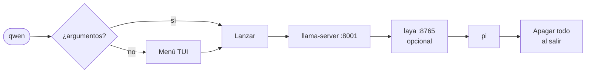

<div align="center">

# ◆ Qwen3.6-35B-A3B · local

**Un LLM de 35B en tu terminal. Un menú. Cero fricción.**

[](#-modelos)
[](#-cómo-funciona)
[](#-perfiles-de-pi)
[-f59e0b?style=for-the-badge)](#-laya--system-1)
[](#-hardware-probado)
[](#-hardware-probado)
[](#-modelos)

<sub>**Pi** (harness de agente) + **llama.cpp** (servidor) + **laya** (clasificador de prompts, opcional) — todo desde un menú TUI.</sub>

</div>

---

## ⚡ Inicio rápido

```bash
./setup/qwen-setup.sh     # una sola vez
source ~/.bashrc
qwen                      # abre el menú
```

| Quiero…                      | Comando                                |
| ---------------------------- | -------------------------------------- |
| Abrir el menú                | `qwen`                                 |
| Menú con Heretic marcado     | `qwenh`                                |
| Lanzar directo con un prompt | `qwen -p "resume este repo"`           |
| Ver estado de todo           | `qwen-status`                          |
| Ver memoria de llama-server  | `qwen-mem`                             |
| Apagar un servidor colgado   | `qwen-stop` (o tecla `x` en el menú)   |

> **Requisitos:** `bash`, `python3`, `curl`, `pi` en el `PATH` (Pi requiere Node.js ≥ 22.19), llama.cpp compilado y los GGUF en `~/models`.

---

## 🧰 Hardware probado

| Componente     | Valor                                                   |
| -------------- | ------------------------------------------------------- |
| **GPU**        | NVIDIA RTX 3060 · 12 GB VRAM                            |
| **RAM**        | 32 GB                                                   |
| **Cuantizado** | **Q4_K_XL** (Base, ~20.8 GB)                            |
| **Contexto**   | 100 000 tokens (KV cache `q8_0`)                        |
| **Reparto**    | `-ngl 99 --n-cpu-moe 28`: todo a GPU salvo los expertos MoE de las primeras 28 capas, que van a RAM |

VRAM medida con Q4_K_XL: ~10.4 GB con 64k de contexto y ~11.3 GB con 131k (umbral 11.5 GB; ver [`docs/benchmarks.md`](docs/benchmarks.md)). Con 32 GB el modelo cabe repartido entre VRAM y RAM, pero el margen es corto: laya añade ~2.3 GB (medido con `multilingual`; el objetivo de ≤ 2048 MB aún no se cumple). Si te quedas justo, usa **IQ3** (~12.3 GB) o baja `QWENX_CTX`.

---

## 🖥️ El menú

Liviano, colorido y sin dependencias (solo librería estándar de Python). Estado **online/offline** en vivo y recuerda tu última selección.

```
╭──────────────────────────────────────────────────────────────────────╮
│ ◆ QWEN3.6-35B  pi · llama.cpp · laya                                 │
│ ○ llama-server offline :8001   ○ laya offline :8765                  │
├─ Modelo ─────────────────────────────────────────────────────────────┤
│ ◉ 1 Base     Q4_K_XL · MoE 35B-A3B                           20.8 GB │
│ ○ 2 Heretic  uncensored Q4_K_M                               20.3 GB │
│ ○ 3 IQ3      ligero IQ3_XXS                            no encontrado │
├─ Opciones ───────────────────────────────────────────────────────────┤
│ [✓] e Edición   write · edit · bash                                  │
│ [ ] v Visión    mmproj F16                                           │
│ [ ] i Incógnito sin guardar sesión                                   │
│ [ ] o Ollama    respaldo · ignora el modelo                          │
│ [✓] s Laya      system 1 · clasifica prompts en CPU                  │
├──────────────────────────────────────────────────────────────────────┤
│ ▶ Lanzar                                  base · edición · laya      │
╰──────────────────────────────────────────────────────────────────────╯
```

| Tecla                 | Acción                                              |
| --------------------- | --------------------------------------------------- |
| `↑` `↓` / `k` `j`     | Mover foco                                          |
| `1`–`3`               | Elegir modelo                                       |
| `e` `v` `i` `o` `s`   | Edición · Visión · Incógnito · Ollama · Laya        |
| `a`                   | Editar argumentos para pi                           |
| `enter` / `espacio`   | Lanzar / activar fila                               |
| `m` · `c` · `l`       | `qwen-mem` · `qwen-status` · Laya independiente     |
| `x`                   | **Apagar** llama-server y laya                      |
| `r` · `q`             | Releer modelos · Salir                              |

---

## 🧠 Modelos

El **mismo Qwen3.6-35B-A3B** en tres variantes. Se usa **una a la vez**.

| Modelo     | Tamaño   | Archivo (patrón en `~/models`)    | Para qué                                   |
| ---------- | -------- | --------------------------------- | ------------------------------------------ |
| **Base**   | ~20.8 GB | `Qwen3.6-35B-A3B-UD-Q4_K_XL.gguf` | Mejor calidad. Uso normal.                 |
| **Heretic**| ~20.3 GB | `*heretic*Q4_K_M*.gguf`           | Variante uncensored / abliterada.          |
| **IQ3**    | ~12.3 GB | `*IQ3_XXS*.gguf`                  | Carga más rápido, libera VRAM/RAM.         |
| mmproj     | —        | `mmproj-*F16*.gguf`               | Solo con la opción **Visión**.             |

---

## 🛠️ Comandos

Sin argumentos abre el menú; con argumentos lanza directo y pasa todo a `pi`.

| Comando                 | Modelo  | Preselección          |
| ----------------------- | ------- | --------------------- |
| `qwen`                  | Base    | lo último que usaste  |
| `qwen-edit`             | Base    | Edición               |
| `qwen-incognito`        | Base    | Incógnito             |
| `qwen-vision`           | Base    | Visión                |
| `qwenh` (+ mismos sufijos) | Heretic | igual que arriba   |
| `qwen-lite`             | IQ3     | —                     |
| `qwen-ollama`           | —       | Ollama                |

Los sufijos se combinan: `qwen-edit-incognito`, `qwenh-vision-incognito`…

---

## 🔐 Perfiles de Pi

Pi corre con `PI_CODING_AGENT_DIR=~/.pi-qwen/agent`, separado de tu config habitual.

| Perfil                | Herramientas                        |
| --------------------- | ----------------------------------- |
| `readonly` (defecto)  | `read, grep, find, ls`              |
| `edit`                | `read, write, edit, bash, grep, find, ls` |

> ⚠️ **Edición** da a Pi escritura y `bash` sin reglas deny/ask. Úsala solo en proyectos de confianza.

Pi no trae subagentes: `--tools` es una lista cerrada y todo ocurre en la sesión principal.

---

## 🧭 Laya · system 1

Clasificador no autoregresivo que corre **en CPU** (no toca VRAM) y evalúa cada prompt en un solo paso:

| Salida          | Qué mide                                             |
| --------------- | ---------------------------------------------------- |
| **complejidad** | simple · media · compleja                            |
| **destructivo** | prob. de borrar / sobreescribir / force-push         |
| **injection**   | prob. de intentar saltarse las reglas                |

Servidor HTTP en `127.0.0.1:8765` (`GET /health`, `POST /classify`). Se activa con la casilla **Laya** (o `QWEN_LAYA=1`, por defecto), arranca cuando Qwen está listo y se apaga con la sesión. Si falla, Qwen sigue funcionando.

**Metas de calidad:** acuerdo ≥ 80 % · latencia mediana ≤ 500 ms · RAM pico ≤ 2048 MB · VRAM sin cambios.

> 🚧 **Estado:** laya corre en paralelo, pero **Pi aún no la consulta**. `laya_hook.py` es un hook de Claude Code. Falta conectarla al sistema de extensiones de Pi. Detalle, benchmarks y pendientes en [`laya/README.md`](laya/README.md).

---

## ⚙️ Cómo funciona



`llama-server`: `-ngl 99 --n-cpu-moe 28 -c 100000 -fa on -ctk q8_0 -ctv q8_0 --jinja` · temp 0.6 · top-p 0.95 · top-k 20.

<details>
<summary><b>📁 Estructura de la repo</b></summary>

```
qwen-local.sh        Punto de entrada (~/.qwen-local.sh es un symlink)
lib/
  config.sh          Rutas, puertos, valores por defecto, resolución de modelos
  laya.sh            Ciclo de vida de laya
  llama.sh           llama-server, Ollama (respaldo), qwen-mem, qwen-stop
  pi.sh              Config de Pi, perfiles, ejecución
menu/
  qwen-menu.py       Menú TUI
setup/
  qwen-setup.sh      Instalador
laya/                Clasificador de prompts
  laya_server.py  laya_hook.py  bench_laya.py  test-laya.sh
  questions.json  config.json   laya_config.py run.sh  prompts.jsonl
kev/  scripts/  monitor.sh
```

Fuera de la repo: `~/.pi-qwen/agent/` (config de Pi), `~/.local/state/qwen/menu.json` (última selección), `~/models/*.gguf`, `~/llama.cpp/build/bin/llama-server`.

</details>

<details>
<summary><b>🔧 Instalación y opciones del instalador</b></summary>

```bash
./setup/qwen-setup.sh              # instala / actualiza
./setup/qwen-setup.sh --check      # revisa sin modificar nada
./setup/qwen-setup.sh --no-laya    # sin preparar el venv de laya
./setup/qwen-setup.sh --uninstall  # quita symlink y línea de ~/.bashrc
```

Crea el symlink `~/.qwen-local.sh`, genera la config de Pi en `~/.pi-qwen/agent`, prepara el venv de laya (red solo la primera vez) y deja una sola línea en `~/.bashrc`.

</details>

<details>
<summary><b>🌐 Variables de entorno principales</b></summary>

| Variable             | Defecto                              | Uso                              |
| -------------------- | ------------------------------------ | -------------------------------- |
| `QWEN_PORT`          | `8001`                               | Puerto de llama-server           |
| `QWEN_MODELS_DIR`    | `~/models`                           | Carpeta de GGUF                  |
| `QWEN_LLAMA_BIN`     | `~/llama.cpp/build/bin/llama-server` | Binario de llama.cpp             |
| `QWENX_CTX`          | `100000`                             | Contexto                         |
| `QWENX_NCMOE`        | `28`                                 | `--n-cpu-moe`                    |
| `QWENX_NOTHINK`      | `0`                                  | `1` desactiva el thinking        |
| `QWEN_PI_NO_SESSION` | `0`                                  | `1` = Pi sin guardar sesión      |
| `QWEN_LAYA`          | `1`                                  | `0` = no arrancar laya           |
| `LAYA_PORT`          | `8765`                               | Puerto de laya                   |
| `LAYA_MODEL`         | (el de `laya/config.json`)           | Pisa el checkpoint               |

</details>

---

## 🩺 Solución de problemas

| Síntoma                               | Solución                                                                |
| ------------------------------------- | ----------------------------------------------------------------------- |
| Servidor colgado / VRAM sin liberar   | Menú → `x`, o `qwen-stop`                                               |
| Puerto 8001 ocupado por otro proceso  | Cambia `QWEN_PORT` o libera el puerto                                   |
| Error 500                             | Probar `QWENX_NOTHINK=1 qwen` (workaround sin confirmar)                |
| Modelo `no encontrado`                | `ls ~/models/*.gguf` y revisa que el nombre contenga el patrón          |
| Visión no lanza                       | Falta `mmproj-*F16*.gguf` en `~/models`                                 |
| `No encuentro el comando 'pi'`        | Instala Pi o añádelo al `PATH`                                          |
| Laya no arranca                       | Se avisa y todo sigue sin laya; revisa `qwen-status`                    |
| Menú deformado                        | Terminal con 256 colores, UTF-8 y ≥ 72 columnas                         |
| Algo no cuadra tras instalar          | `./setup/qwen-setup.sh --check`                                         |

---

## 📚 Documentación

| Documento | Contenido |
| --- | --- |
| [`docs/benchmarks.md`](docs/benchmarks.md) | Decisiones y mediciones: `--n-cpu-moe`, batch, VRAM vs contexto, A/B de cuantizaciones |
| [`laya/README.md`](laya/README.md) | Clasificador laya: uso, resultados, limitaciones, pendientes |
| [`docs/pi-qwen-referencia-v2.md`](docs/pi-qwen-referencia-v2.md) | Pi: skills, prompts, extensions, AGENTS.md y subagentes con modelo local |
| [`docs/README.md`](docs/README.md) | Referencia técnica completa: módulos, variables de entorno, historial de cambios |

---

## 🗺️ Pendientes

- [ ] Conectar laya a Pi (extensiones/hooks de Pi)
- [ ] Ampliar `prompts.jsonl` a ~100 y calibrar umbrales
- [ ] Decidir checkpoint final de laya: `typed-decisions` vs `multilingual`
- [ ] Medir VRAM con el contexto por defecto actual (100 000) y alinearlo con lo medido (131 072)

---

<div align="center">
<sub>Hecho para correr un MoE de 35B en una GPU de 12 GB. · <a href="#-inicio-rápido">Ir a inicio rápido ↑</a></sub>
</div>
